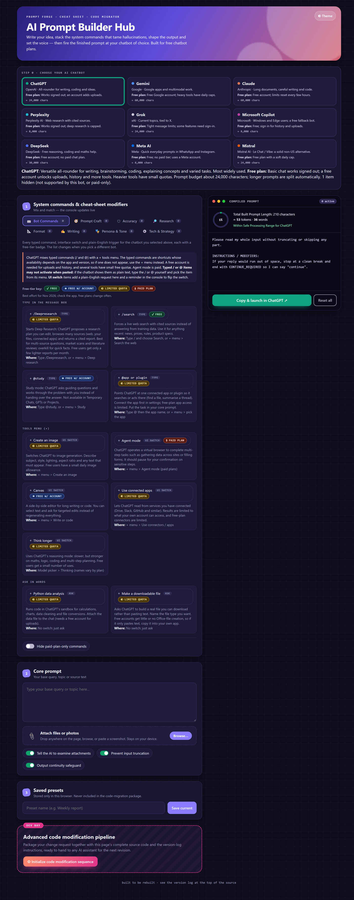

# AI Prompt Builder & Code Migrator

A zero-dependency, single-file web application designed by a non-coder to help everyday users—especially fellow non-coders—get the most out of free AI chatbots, while staying open source and directly editable by those same AI chatbots.

You don't need a coding background, developer tools, local servers, or an expensive paid subscription to use it. Open it in your browser, shape rough ideas into clear prompts, copy them into your favorite chatbot, and keep moving.

## Try It

- **Live in Browser (GitHub Pages):** [Open AI Prompt Builder](https://genx-shinobi.github.io/Prompt-Builder/)
- **View or Download Current File (`v5.2.0`):** [index.html](index.html)

## Core Mission

- **Built for Non-Coders & Everyday Tinkers:** Plain-English prompt building and step-by-step workflows made for people who aren't software engineers—whether you're writing, researching, planning, or building simple web tools with AI help.
- **Free-Tier First:** Built around free chatbot plans (with free accounts where required for uploads, history, or connectors). Every bot command includes a high-contrast free-tier availability badge (`Free`, `Free w/ account`, `Limited quota`, `Paid plan`), conservative paste budgets, and automatic multi-part prompt splitting when a prompt exceeds a bot's safe paste limit.
- **Self-Contained & AI-Editable:** The entire application lives in a single `.html` file (`index.html`) with zero build steps, external libraries, or backend servers. Its built-in Dev Bay packages your change request alongside a clean snapshot of the app's source code, version-log rules, and a command freshness check so any AI chatbot can generate the next version.

## Versions & Older Releases

- **Current Version (`v5.2.0`):** Maintained in [index.html](index.html) and served on the live page above.
- **Older Versions:** Earlier builds (`v5.1`, `v5.1.1`, and earlier prototypes) are stored in the [archive/](archive/) folder, with versioned snapshots available under [Releases](https://github.com/GenX-Shinobi/Prompt-Builder/releases).

## Documentation

- **Guides & Reference PDFs:** Browse project documentation, release notes, and revision guides in the [docs/](docs/) folder.
- **Contribution & Dev Bay Rules:** See [contributing.md](contributing.md) for single-file design rules and AI-assisted revision steps.

## Supported Chatbots (Free-Tier Baseline — 9 Engines)

Each chatbot card displays task-fit guidance, free-tier availability notes, and conservative character paste budgets:

- **ChatGPT (OpenAI):** Everyday all-rounder (`≈ 24,000` chars) with web/research modes, study/app helpers, Canvas, data analysis, and image tools where available.
- **Gemini (Google):** Google Workspace `@` Connected Apps (`≈ 60,000` chars), Tools menu (Deep Research, Canvas, Guided Learning, image/music), and built-in Maps/Flights/Hotels/YouTube queries.
- **Claude (Anthropic):** Long documents (`≈ 60,000` chars), careful writing, Artifacts, styles, connectors (`Free w/ account`), and code/file creation.
- **Perplexity (Perplexity AI):** Citation-backed web, academic, finance, and attached-file research (`≈ 8,000` chars).
- **Grok (xAI):** Conversational assistant (`≈ 24,000` chars) with search/DeepSearch, reasoning modes, image tools, and live X (Twitter) search.
- **Microsoft Copilot:** Everyday assistant (`≈ 8,000` chars) with task-fit guidance and free-tier command filtering.
- **DeepSeek:** Long-context drafting and coding (`≈ 30,000` chars) tuned for free-tier usage.
- **Meta AI:** Quick conversational tasks (`≈ 8,000` chars) with free-tier command filtering.
- **Mistral (Le Chat / Vibe):** Fast, structured drafting and coding (`≈ 24,000` chars) with free-tier command filtering.

## Quickstart

### Run Locally

1. Download [index.html](index.html) (or grab an older build from [archive/](archive/)).
2. Double-click the file to open it in any modern web browser. No installation, server, or internet connection is required to build prompts.

### Build & Launch a Prompt

- **Step 0 — Choose your AI chatbot:** Pick from the 9 supported chatbots to set its free-plan paste budget, view task-fit notes, and filter commands to what that bot supports.
- **Step 1 — System commands & cheat-sheet modifiers:** Mix and match commands across Bot Commands, Prompt Craft, Accuracy, Research, Format, Writing, Persona & Tone, and Tech & Strategy. Fill in any inline `[bracketed]` fields that appear, and use **Hide paid-plan-only commands** at the bottom of the card to filter out paid-tier items.
- **Step 2 — Core prompt & attachments:** Enter your query or source text. Drag, browse, or paste (`Ctrl/Cmd+V`) files or screenshots—small text files (`≤1 MB`) can be inlined into the prompt, while images and larger files are staged locally with upload/copy reminders. Adjust the truncation and continuity toggles as needed.
- **Step 3 — Saved presets (optional):** Save frequently used setups to your browser's `localStorage` (`pb-presets-v1`). Presets never leave your device and are never included in code-migration exports.
- **Copy & launch:** Click **Copy & launch** in the right-hand console to copy the compiled prompt (or Part 1 of an auto-split sequence) and open your chosen chatbot in a new tab.

### Update the App Using an AI Chatbot (Dev Bay)

1. Scroll to the **DEV BAY** section and click **Initialize code modification sequence**.
2. Choose the target AI engine, describe the change you want, and state why it is needed.
3. Click **Generate package**, then use **Copy package & launch** (which auto-splits packages that exceed the target engine's paste budget) or **Download clean .html** to attach the clean source file directly.
4. Paste the copied package (or attach the downloaded `.html` file) into the AI chatbot—the package includes a mandatory freshness check so the AI verifies current commands/features before emitting the complete updated `.html` file.
5. Save the returned `.html` file and verify it in your browser before publishing.

## AI Assistance Note

This project's code and revisions were created and iterated with AI assistance and reviewed through testing. Because users can also edit the single-file HTML directly with AI chatbots, edge cases may vary—please test changes and report issues if you spot bugs. See [contributing.md](contributing.md) for revision and Dev Bay guidelines.

## Privacy & Local Storage

- **100% Client-Side:** Your prompts, attached files, and saved presets never leave your browser until you explicitly paste or upload them into a chatbot tab.

**Browser Storage Keys:**
- `pb-theme` — Light/dark theme preference.
- `pb-presets-v1` — User-saved prompt presets.

## Creator & Gameplay

Made by a regular person sharing practical tools for non-coders and tinkering with AI workflows. Outside of building tools like this, I also publish gameplay streams on [Twitch](https://www.twitch.tv/genx_shinobi).

## License

Released under the MIT License.
